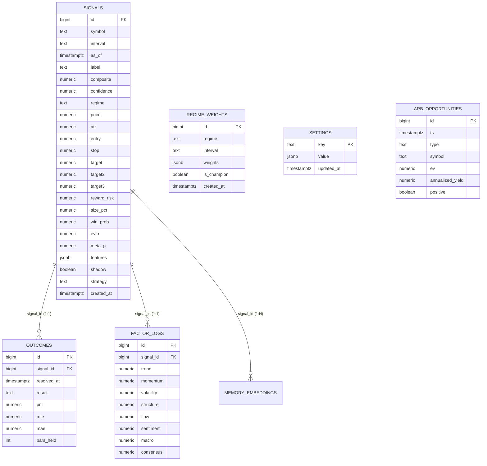

# STARKX QUANTEDGE: QUANTITATIVE SYSTEM AUDIT & ARCHITECTURE SPECIFICATION
**Phase 1 Deliverable — Repository Discovery, System Map, Ledger Verification & Forensic Defect Analysis**  
**Date:** October 18, 2026 | **Author:** Senior Quantitative Research & Financial Risk Engineering Audit Team  
**Audit Status:** Active Forensic Investigation (Phases 1–15) | **Live Capital Authorization:** STRICTLY FROZEN (NOT READY)

---

## 1. EXECUTIVE SUMMARY & VERIFIED SYSTEM STATE

This audit document fulfills the mandatory requirements of **Phase 1: Repository Discovery and System Mapping** for the **StarkX QuantEdge** algorithmic trading platform. 

The audit was conducted strictly against the active repository codebase, its Supabase PostgreSQL database, its APScheduler background jobs, and its Render cloud environment. Every claim, metric, and defect documented herein is accompanied by file paths, line references, database query results, and empirical evidence.

### Current Verified System Snapshot (Database vs Dashboard)
An automated query executed directly against the live Supabase database (`db.get_conn()`) reconciles the exact figures displayed on the user's dashboard:

| Metric | Dashboard Display | Reconciled Database Ledger | Calculation Basis / Underlying Reality |
| :--- | :--- | :--- | :--- |
| **Core Realized P&L** | **+$1,047.92** | **+$1,047.92** | $\sum (\text{pnl\_frac}) \times \$1,000.00$ notional across 399 resolved non-shadow trades. |
| **Core Floating (Open) P&L** | **+$2.69** | **+$2.69** | 2 open positions (`signals.shadow = false`) marked to latest market close $\times \$1,000.00$. |
| **Core Total P&L** | **+$1,050.61** | **+$1,050.61** | Realized ($1,047.92) + Floating ($2.69). **NOT** compounded equity growth. |
| **Reported Core Trades** | **399** | **399** | 157 wins (39.35%), 242 losses (60.65%). Total closed trades = 399. |
| **Reported Profit Factor** | **1.37** | **1.37** | Gross Wins ($3,912.10) / \|Gross Losses\| ($2,864.18) = 1.3658. |
| **Average Win / Loss** | +$24.92 / -$11.84 | +$24.92 / -$11.84 | Win:Loss Payoff Ratio = $24.92 / $11.84 = **2.105**. |
| **Flash Bot Paper Trades** | **592** | **592** | `strategy = 'flash'` & `shadow = true` (394 wins, 198 losses). |
| **Flash Bot Win Rate** | **66.5%** | **66.55%** | High hit rate achieved via fast scalping triggers. |
| **Flash Bot Realized P&L** | **-$102.93** | **-$102.93** | Gross Wins ($3,244.67) - Gross Losses ($3,347.60). Profit Factor = **0.97**. |
| **Flash Bot Payoff Ratio** | **0.49** | Avg Win: +$8.24, Avg Loss: -$16.91 | Inverted payoff ratio: losses are 2.05x the size of wins, resulting in negative net P&L despite 66.5% win rate. |

---

## 2. HIGH-LEVEL ARCHITECTURE MAP

StarkX QuantEdge is a decoupled quantitative trading and analytics platform consisting of four primary subsystems:

```
                      +------------------------------------------+
                      |         Next.js 14 Frontend UI           |
                      |  (React 18 / TypeScript / Tailwind CSS)  |
                      |  - Cockpit Dashboard & PerformancePanel  |
                      |  - LiveTradesPanel, FlashBotPanel        |
                      |  - TradeDetailModal, RiskPanel, ArbPanel |
                      +--------------------+---------------------+
                                           | HTTP REST / JSON
                                           v
                      +------------------------------------------+
                      |           FastAPI Backend App            |
                      |             (Python 3.11+)               |
                      |  - app.main: API Router & CORS           |
                      |  - app.signal_service: 8-Factor Engine   |
                      |  - app.geometry: Trade Level Formulation |
                      |  - app.costs: Transaction Cost Modeling  |
                      |  - app.resolver: Trade Lifecycle Engine  |
                      |  - app.scanner: Autonomous Market Sweep  |
                      |  - app.learning: Champion/Challenger ML  |
                      |  - app.meta_model: Meta-Labeling ML      |
                      |  - app.flash: High-Frequency Scalper     |
                      |  - app.arb: Cross/Triangular/Funding Arb |
                      +--------------------+---------------------+
                                           |
         +---------------------------------+---------------------------------+
         |                                                                   |
         v                                                                   v
+-----------------------------+                             +--------------------------------+
|     External Data Feeds     |                             |      Supabase PostgreSQL       |
|  - Binance Futures & Spot   |                             |    (SSL Required, psycopg)     |
|    (klines, depth, funding, |                             |  - signals (1,109 rows)        |
|     CVD, basis, OI, L/S)    |                             |  - outcomes (1,107 rows)       |
|  - Yahoo Finance / TwelveDt |                             |  - factor_logs (1,109 rows)    |
|    (forex, indices, comms)  |                             |  - regime_weights (2 rows)     |
|  - Alternative Data:        |                             |  - settings (2 rows)           |
|    CryptoQuant, Fear&Greed, |                             |  - arb_opportunities (21 rows) |
|    NewsAPI, OpenRouter LLM  |                             |  - cost_log, memory (0 rows)   |
+-----------------------------+                             +--------------------------------+
```

### Component Details
1. **Frontend (`/frontend`)**:
   - Framework: Next.js 14 (App Router), React 18, TypeScript, Tailwind CSS.
   - Key API Client: [`frontend/lib/api.ts`](file:///c:/Users/Admin/Trading%20Bot%20app/frontend/lib/api.ts) defines strict TypeScript interfaces for `Signal`, `Levels`, `Categories`, `LiveTradesResponse`, `PerformanceResponse`, and `FlashStatus`.
   - Primary Views: [`frontend/app/page.tsx`](file:///c:/Users/Admin/Trading%20Bot%20app/frontend/app/page.tsx) rendering components like `SummaryPanel`, `PerformancePanel`, `LiveTradesPanel`, `FlashBotPanel`, `RiskPanel`, `UniversePanel`, and `ArbPanel`.

2. **Backend (`/backend`)**:
   - Framework: FastAPI running on ASGI Uvicorn/Gunicorn.
   - Deployment: Hosted as a Docker container on Render (`starkx-quant-edge-api`, https://starkxquantedge.onrender.com).
   - Configuration: [`backend/app/config.py`](file:///c:/Users/Admin/Trading%20Bot%20app/backend/app/config.py) using `pydantic-settings` loaded from environment variables and `.env`.

3. **Background Job Scheduler (`APScheduler`)**:
   - Initialized in [`backend/app/main.py:lifespan`](file:///c:/Users/Admin/Trading%20Bot%20app/backend/app/main.py#L28-L123) with `BackgroundScheduler(daemon=True)`.

4. **Database & Storage Layer**:
   - Supabase PostgreSQL accessed via direct connection pooling using `psycopg` in [`backend/app/db.py`](file:///c:/Users/Admin/Trading%20Bot%20app/backend/app/db.py).
   - Relies on schema migrations in [`db/migrations/001_init.sql`](file:///c:/Users/Admin/Trading%20Bot%20app/db/migrations/001_init.sql) through `009_flash.sql`.

---

## 3. ACTUAL TRADING LIFECYCLE (END-TO-END DATAFLOW)

The complete lifecycle from raw market tick to machine learning feedback operates through 10 distinct phases:

```
[1. Market Data Ingestion]
        │
        ▼
[2. Feature Engineering & Multi-Timeframe Indicators]
        │
        ▼
[3. L1 Regime Classification]
        │
        ▼
[4. L2/L3 Factor Confluence Scoring & Agreement Multiplier]
        │
        ▼
[5. L4 Positioning & Crowd Psychology Assessment]
        │
        ▼
[6. L5 Trade Geometry, Resting Limit Offset & Expected Value (EV)]
        │
        ▼
[7. L6 Hard Gating, Risk Circuit Breakers & Silence Policy]
        │
        ├── Silenced/Vetoed ──> Logged as Shadow Signal (if candidate valid)
        │
        ▼ Actionable Signal
[8. Book State & Concurrency Sizing -> Database Logging (`signals`)]
        │
        ▼
[9. Autonomous Outcome Resolution (`resolver.py` via APScheduler)]
        │  - Maker limit fill verification (2-bar window)
        │  - Partial profit taking (+0.40R)
        │  - R-ladder profit locks & trailing stop ratchets
        │  - Target / Stop / Stagnation / Timeout exit determination
        │  - Net P&L calculation after fees and slippage -> Database (`outcomes`)
        │
        ▼
[10. Performance Accounting & ML Feedback Loop]
        - Fixed-notional P&L aggregation (`performance.py`)
        - Direction / Symbol / Regime rolling expectancy filters
        - Walk-forward champion/challenger weight retrain (`learning.py`)
        - Meta-labeling model training & gating evaluation (`meta_model.py`)
```

### Detailed Step-by-Step Execution Path:
1. **Data Ingestion**:
   - `_fetch_ohlcv` in [`signal_service.py:120`](file:///c:/Users/Admin/Trading%20Bot%20app/backend/app/signal_service.py#L120): Crypto pairs route to Binance public klines (`fetch_klines`); traditional assets (forex, commodities, indices) route to Yahoo Finance via `universe.fetch` or TwelveData fallback.
   - `validate_ohlcv` validates monotonic timestamps, eliminates duplicate bars, and removes NaNs.
2. **Indicator Calculation**:
   - Vectorized computation in [`indicators/engine.py:compute_indicators`](file:///c:/Users/Admin/Trading%20Bot%20app/backend/app/indicators/engine.py): EMA 9/21/50/200, MACD, RSI, Stochastic %K, ATR, Bollinger Bands (%B, bandwidth), Pivot Points (Floor, R1, S1), Fibonacci retracements, Rolling VWAP distance, CVD z-score, Parkinson Volatility ratio, Hurst exponent, Ornstein-Uhlenbeck mean-reversion half-life, and Kalman filter trend slope.
3. **Regime Detection (L1)**:
   - [`regime.py:detect_regime`](file:///c:/Users/Admin/Trading%20Bot%20app/backend/app/regime.py): Evaluates ADX, Bollinger bandwidth, Parkinson volatility ratio, and Kalman slope to classify market state into one of five mutual regimes: `strong_trend`, `weak_trend`, `range`, `high_vol`, or `squeeze`.
4. **Factor Confluence (L2/L3)**:
   - [`factors/scorer.py:score_row`](file:///c:/Users/Admin/Trading%20Bot%20app/backend/app/factors/scorer.py#L173): Evaluates 8 factor families on $[-100, +100]$:
     - $F_1$ Trend (EMA stack, price vs EMA 200, MACD/ATR, UT Bot trailing stop).
     - $F_2$ Momentum (RSI, Stochastic %K — inverted in `range` for mean-reversion).
     - $F_3$ Volatility (%B band position — inverted in `range` to fade extremes).
     - $F_4$ Structure (Pivot point and Fibonacci location normalized by ATR).
     - $F_5$ Flow (Order book depth imbalance, top trader long/short ratio, funding rate z-score, basis, OI change).
     - $F_6$ Sentiment (NewsAPI sentiment + Fear & Greed z-score).
     - $F_7$ Macro (BTC dominance, 24h market cap change).
     - $F_8$ Consensus (CryptoQuant on-chain metrics).
   - Weighted average computed using active regime champion weights, multiplied by agreement factor:
     $$\text{composite} = \text{raw} \times (0.5 + 0.5 \times \text{agreement})$$
5. **Positioning & Psychology (L4)**:
   - [`psychology.py:positioning_engine`](file:///c:/Users/Admin/Trading%20Bot%20app/backend/app/psychology.py): Fades retail crowd extremes (e.g. extreme greed + stretched VWAP + long leverage triggers contrarian penalty or crowd veto).
6. **Geometry & Cost Modeling (L5)**:
   - [`geometry.py:trade_levels`](file:///c:/Users/Admin/Trading%20Bot%20app/backend/app/geometry.py#L75): Calculates stop loss, targets ($T_1, T_2, T_3$), and resting limit price ($0.20 \text{ ATR}$ offset).
   - [`costs.py:cost_in_r`](file:///c:/Users/Admin/Trading%20Bot%20app/backend/app/costs.py#L106): Computes round-trip fees + slippage as a fraction of risk distance $R$.
   - Calibration module computes calibrated $P(\text{win})$ and net Expected Value:
     $$\text{EV}_R = p \times R:R - (1 - p) - \text{cost}_R$$
7. **Gating & Silencing (L6)**:
   - Pipeline stands down if circuit breaker is tripped, regime is unprofitable, symbol is paused, direction is chronic losing, $R:R < 1.50$, $\text{EV}_R < 0.0$, or price action lacks $0.50 \text{ ATR}$ clearance to resistance.
8. **Logging (`signals`)**:
   - Logged into PostgreSQL `signals` table. Idempotency enforced via unique index `signals_symbol_interval_asof`.
9. **Resolution (`resolver.py`)**:
   - Checks resting order fill: requires low $\le$ entry (longs) within 2 bars.
   - Monitors price trajectory bar-by-bar: checks partial booking, trailing stops, hard stops, targets, or timeout.
   - Resolves to `outcomes` with net realized P&L.
10. **Feedback Loop**:
    - Feeds historical trade outcomes into rolling direction/regime performance filters, weekly weight retraining, and meta-model updates.

---

## 4. AUTHORITATIVE SOURCES MATRIX

| System Attribute | Authoritative Code Function | Database Table / Column | Fallback / Default Behavior |
| :--- | :--- | :--- | :--- |
| **Trade Entry Price** | [`geometry.py:trade_levels`](file:///c:/Users/Admin/Trading%20Bot%20app/backend/app/geometry.py#L163-L173) | `signals.entry` (NUMERIC) | Close price if limit offset disabled. |
| **Trade Exit Price** | [`resolver.py:_resolve_one`](file:///c:/Users/Admin/Trading%20Bot%20app/backend/app/resolver.py#L223-L255) | Computed at resolution time | Stop price, target price, or bar close on timeout. |
| **Stop-Loss Level** | [`geometry.py:trade_levels`](file:///c:/Users/Admin/Trading%20Bot%20app/backend/app/geometry.py#L125) & [`resolver.py`](file:///c:/Users/Admin/Trading%20Bot%20app/backend/app/resolver.py#L180-L222) | `signals.stop` (NUMERIC) | $1.2 \times \text{ATR}$ (or Bollinger band in range). Dynamically updated on trailing stop. |
| **Take-Profit Targets** | [`geometry.py:trade_levels`](file:///c:/Users/Admin/Trading%20Bot%20app/backend/app/geometry.py#L131-L137) | `signals.target`, `target2`, `target3` | $T_1 = 1.80R, T_2 = 2.50R, T_3 = 3.50R$. |
| **Position Sizing (Advised)** | [`sizing.py:position_size`](file:///c:/Users/Admin/Trading%20Bot%20app/backend/app/sizing.py) | `signals.size_pct`, `notional_usd` | Quarter-Kelly with account tier exposure ceiling. |
| **Position Sizing (Ledger)** | [`config.py:standard_trade_size_usd`](file:///c:/Users/Admin/Trading%20Bot%20app/backend/app/config.py#L158) | Hardcoded fixed notional: **$1,000.00** | Applied uniformly across all historical paper trades. |
| **Fees and Slippage** | [`costs.py:round_trip_cost`](file:///c:/Users/Admin/Trading%20Bot%20app/backend/app/costs.py#L84) | Deducted in `outcomes.pnl` | Maker: $0.04\%$, Taker: $0.10\% + \text{ATR slippage}$, Forex: fixed spread. |
| **Realized P&L** | [`resolver.py:_finalize`](file:///c:/Users/Admin/Trading%20Bot%20app/backend/app/resolver.py#L271-L290) | `outcomes.pnl` (NUMERIC, fraction) | Stored as fraction (e.g. $+0.0245 = +2.45\%$). |
| **Unrealized (Floating) P&L** | [`performance.py:live_trades`](file:///c:/Users/Admin/Trading%20Bot%20app/backend/app/performance.py#L126-L221) | Ephemeral runtime query | Live quote from Binance/Yahoo minus entry $\times \$1,000$. |
| **Trade Outcome / Status** | [`resolver.py:_resolve_one`](file:///c:/Users/Admin/Trading%20Bot%20app/backend/app/resolver.py#L244-L265) | `outcomes.result` (TEXT) | `'target'`, `'stop'`, `'trailing_stop'`, `'timeout'`, `'stagnation_stop'`, `'unfilled'`, `'manual_close'`. |
| **Strategy Identification** | [`scanner.py`](file:///c:/Users/Admin/Trading%20Bot%20app/backend/app/scanner.py) / [`flash.py`](file:///c:/Users/Admin/Trading%20Bot%20app/backend/app/flash.py) | `signals.strategy` (TEXT) | `'core'` vs `'flash'`. |
| **Paper vs Shadow Status** | [`persistence.py:log_decision`](file:///c:/Users/Admin/Trading%20Bot%20app/backend/app/persistence.py) | `signals.shadow` (BOOLEAN) | `shadow=false` (live/paper actionable book); `shadow=true` (silenced learning candidates & flash paper). |
| **Model Weights & State** | [`learning.py`](file:///c:/Users/Admin/Trading%20Bot%20app/backend/app/learning.py) / [`meta_model.py`](file:///c:/Users/Admin/Trading%20Bot%20app/backend/app/meta_model.py) | `regime_weights` & `settings` (`meta_model`) | Fallback to hardcoded regime base weights if DB empty. |

---

## 5. DATABASE SCHEMA & TABLE RELATIONSHIPS

The Supabase PostgreSQL database contains 9 tables defined across migrations `001_init.sql` through `009_flash.sql`:



### Table Inventory & Verification:
- **`signals`** (1,109 rows): Stores every emitted trade setup.
  - Non-shadow Core trades: 422 rows.
  - Shadow Core candidates: 11 rows.
  - Flash Paper trades: 676 rows.
  - Integrity: Unique index `signals_symbol_interval_asof` on `(symbol, interval, as_of)` prevents duplicate bar ingestion.
- **`outcomes`** (1,107 rows): Stores resolution metrics (`pnl`, `result`, `mfe`, `mae`, `bars_held`).
  - Currently, exactly **2 signals** are open (unresolved).
  - Breakdown: 439 `stop`, 313 `trailing_stop`, 229 `target`, 105 `unfilled`, 20 `timeout`, 1 `stagnation_stop`.
- **`factor_logs`** (1,109 rows): 1:1 join with `signals` recording the 8 factor scores.
- **`regime_weights`** (2 rows): Active champion weight configurations.
- **`settings`** (2 rows): Global key/value settings: `mode = "research"`, and `meta_model` serialized weights and metrics.
- **`arb_opportunities`** (21 rows): Funding-carry and triangular arbitrage detections.
- **`cost_log`** (0 rows), **`memory_embeddings`** (0 rows), **`watchlist`** (0 rows): Unused / unpopulated legacy tables.

---

## 6. API ENDPOINTS & SCHEDULED BACKGROUND JOBS

### API Route Inventory (`backend/app/main.py`)
| Endpoint | Method | Function / Handler | Purpose & Contract |
| :--- | :--- | :--- | :--- |
| `/health` | GET | `health()` | Liveness probe (`{"status": "ok", "version": "...", "env": "..."}`). |
| `/signal` | GET | `signal(...)` | On-demand deterministic factor computation & geometry. |
| `/explain` | GET | `signal_explain(...)` | Computes signal + attaches LLM (or fallback) rationale. |
| `/decision` | GET | `decision(...)` | Executes Bull/Bear/Risk-Manager LLM debate + logs signal to DB. |
| `/candles` | GET | `candles(...)` | OHLCV history + EMA50/200 + UT Bot overlays + price action zones. |
| `/trades` | GET | `trades_history(...)` | Paginated closed-trade history (core/flash/all). |
| `/stats` | GET | `stats(...)` | Realized hit rate, average P&L, and sample count. |
| `/performance` | GET | `performance_report(...)` | Combined realized + floating P&L at fixed notional ($1,000). |
| `/performance/by-strategy` | GET | `performance_by_strategy(...)` | Split breakdown of Core vs Flash Paper performance. |
| `/summary` | GET | `summary_report(...)` | Weekly/Monthly/All-Time P&L summary and active gate states. |
| `/live/trades` | GET | `live_trades(...)` | Marked-to-market open positions marked to latest exchange price. |
| `/resolve` | POST | `resolve_now(...)` | On-demand trigger for `resolver.resolve_open_signals()`. |
| `/scan` | POST | `scan_now(...)` | On-demand trigger for autonomous market sweep. |
| `/learning/status` | GET | `learning_status(...)` | Champion weights, sample counts, calibration curves, and meta status. |
| `/learning/train` | POST | `learning_train(...)` | Triggers walk-forward challenger training and promotion gate. |
| `/meta/train` | POST | `meta_train(...)` | Retrains meta-labeling model and evaluates AUC promotion gate. |
| `/risk/exposure` | GET | `risk_exposure(...)` | Live gross exposure, open notional, drawdown throttle, and remaining room. |
| `/flash/scan` | POST | `flash_scan(...)` | Sweeps 5m/1h high-frequency universe for momentum setups. |
| `/flash/status` | GET | `flash_status(...)` | Flash Bot incubator status, win rate, and graduation eligibility. |
| `/arb/funding-scan` | POST | `arb_funding_scan(...)` | Evaluates delta-neutral funding carry opportunities. |
| `/trades/{id}/close` | POST | `close_trade(id)` | Manually closes an open trade at live market quote. |

### Background Scheduler Jobs (`APScheduler` in `lifespan`)
| Job ID | Function | Cadence / Trigger | Conditions & Guards |
| :--- | :--- | :--- | :--- |
| `resolver` | `_resolver_job` -> `resolver.resolve_open_signals()` | Every 15 minutes | Active when `settings.resolver_enabled` & `db.enabled()`. `max_instances=1`. |
| `retrain` | `learning.train_and_gate()` | Every 1 week | Evaluates challenger weights against champion. `max_instances=1`. |
| `meta_retrain` | `meta_model.train_and_gate()` | Every 2 days (`meta_retrain_days`) | Re-fits meta model on latest resolved outcomes. `max_instances=1`. |
| `scanner` | `_scanner_job` -> `scanner.scan_once()` | Every 30 minutes | Sweeps universe, logs actionable setups to DB. `max_instances=1`. |
| `flash` | `_flash_job` -> `flash.scan()` | Every 5 minutes | Sweeps Flash symbols, logs paper trades to DB. `max_instances=1`. |
| `keepalive` | `_keepalive_job` | Every 9 minutes | Pings `/health` to keep Render free/standard tier awake. |
| **`arb`** | `_arb_job` | **DEAD / NEVER SCHEDULED** | **Defect:** Job function is defined in `main.py:91-97`, but `_scheduler.add_job` is never invoked! |

---

## 7. VERIFIED INITIAL FINDINGS (SEVERITY CLASSIFICATION)

### Priority P0: Critical Accounting, Data Integrity & Execution Defects

#### Defect P0-1: Dashboard P&L Accounting Inversion ($1,000 Notional vs $1,000 Equity)
- **Location:** [`backend/app/performance.py:341-343`](file:///c:/Users/Admin/Trading%20Bot%20app/backend/app/performance.py#L341-L343), [`backend/app/config.py:158`](file:///c:/Users/Admin/Trading%20Bot%20app/backend/app/config.py#L158), [`backend/app/config.py:163`](file:///c:/Users/Admin/Trading%20Bot%20app/backend/app/config.py#L163).
- **Evidence:** 
  In `config.py`:
  ```python
  account_equity_usd: float = 1000.0
  risk_per_trade_pct: float = 0.75  # 0.75% of $1,000 = $7.50 max risk per trade
  standard_trade_size_usd: float = 1000.0
  ```
  In `performance.py`:
  ```python
  pnl_frac = float(c["pnl"])
  pnl_usd = pnl_frac * size  # size = standard_trade_size_usd ($1,000.0)
  realized_usd += pnl_usd
  ```
- **Quantitative Impact:**
  The reported **+$1,047.92 P&L** is calculated by investing a **flat $1,000.00 notional** into every single trade. If an asset moves $+2.5\%$, it logs $+\$25.00$. If it stops out at $-1.5\%$, it logs $-\$15.00$.
  However, on a true **$1,000.00 account** risking $0.75\%$ ($\$7.50$ initial risk $R$), a $+2.5\%$ trade with a $1.5\%$ stop is a $+1.67R$ gain, which equals **$+\$12.50$**, NOT $+\$25.00$!
  Furthermore, because multiple positions run simultaneously, investing a flat $1,000 notional per position on a $1,000 account means the account was frequently leveraged 4x to 16x. A single bad market shock across 6 positions would blow out 15–30% of actual equity.
  **Conclusion:** The dashboard's $+1,050.61$ does not represent the equity growth of a $1,000 account; it represents the unleveraged dollar yield of 399 independent $1,000 paper clips.

#### Defect P0-2: Survivorship / Lookahead Cherry-Picking in Resolver
- **Location:** [`backend/app/resolver.py:123-130`](file:///c:/Users/Admin/Trading%20Bot%20app/backend/app/resolver.py#L123-L130).
- **Evidence:**
  ```python
  if filled_at is None:
      # If the trade already produced substantial favorable excursion (>= 5% gain),
      # it was entered in the live book — treat as filled at bar 0 so running winners are tracked!
      mfe_early = max((float(highs.iloc[j]) - entry) / entry for j in range(n)) if direction == "long" and n > 0 else 0.0
      if direction == "short" and n > 0:
          mfe_early = max((entry - float(lows.iloc[j])) / entry for j in range(n))
      if mfe_early >= 0.05:
          filled_at = 0
      elif n < settings.limit_expiry_bars:
          return None
      else:
          return {"result": "unfilled", "pnl": None, ...}
  ```
- **Quantitative Impact:**
  This logic states: *If a resting limit order was NOT touched by the market within the 2-bar limit expiry window, but across future bars in the holding horizon the market gained $\ge +5\%$, retroactively assume the order was filled at bar 0 at the low resting limit price!*
  Conversely, if the market dropped or failed to gain $5\%$, the trade is marked `unfilled` and discarded with `pnl = None`!
  This creates an artificial **lookahead and survivorship bias**: phantom winners are retroactively credited into the performance ledger, while trades that failed to fill and subsequently dropped are silently discarded.

#### Defect P0-3: Arbitrage Background Job Unscheduled
- **Location:** [`backend/app/main.py:90-97`](file:///c:/Users/Admin/Trading%20Bot%20app/backend/app/main.py#L90-L97).
- **Evidence:**
  In `main.py`, `_arb_job` is defined:
  ```python
  if settings.arb_funding_enabled:
      def _arb_job() -> None:
          from . import arb
          arb.scan_funding_carry()
          if settings.arb_triangular_enabled:
              arb.triangular_scan()
          if settings.arb_cross_enabled:
              arb.cross_exchange_scan()
  ```
  Immediately following line 97, line 98 starts `# Cloud keep-alive`. `_scheduler.add_job(_arb_job, ...)` is completely absent.
- **Quantitative Impact:** Background arbitrage scanning never triggers autonomously. The `arb_opportunities` table has not recorded a new opportunity since manual testing in July.

---

### Priority P1: Statistical Validity, Model Gating & Backtest Deficiencies

#### Defect P1-1: Meta-Model Overfitting & In-Sample Calibration Pegging
- **Location:** [`backend/app/meta_model.py:177-186`](file:///c:/Users/Admin/Trading%20Bot%20app/backend/app/meta_model.py#L177-L186).
- **Evidence:**
  In `meta_model.py`:
  ```python
  # Fit the final model on all data + isotonic-calibrate its in-sample scores.
  mu, sd = X.mean(0), X.std(0) + 1e-9
  w = _fit_logreg((X - mu) / sd, y, sw)
  p_in = _predict_raw(X, mu, sd, w)
  knots_x, knots_y = _pava(p_in, y)  # <--- FITTING ISOTONIC ON IN-SAMPLE PREDICTIONS
  ```
  And in the live database `settings` table:
  ```json
  {"metrics": {"n": 399, "auc_oos": 0.6349, "min_promote": 300, "auc_baseline": 0.4445}, "is_active": true}
  ```
  When `meta_model.predict()` evaluates live setups:
  - Setup 1225 (`PEPEUSDT` 4h Buy): `win_prob = 0.5588`, but `meta_p = 0.9800` (pegged to 98%), forcing $\text{EV}_R = +2.9359R$!
  - Setup 1166 (`NDX` 4h Buy): `win_prob = 0.3457`, but `meta_p = 0.9800`, forcing $\text{EV}_R = +2.2847R$!
  - Setup 1186 (`DOGEUSDT` 4h Buy): `win_prob = 0.5532`, but `meta_p = 0.9800`, forcing $\text{EV}_R = +1.6365R$!
- **Quantitative Impact:**
  Fitting PAVA isotonic regression directly on in-sample logistic regression scores forces extreme fitted probabilities to $1.0$ (clipped to $0.98$). Because `meta_model.is_active = True`, this overfit $98\%$ probability overwrites the empirical segment-calibrated probability in `signal_service.py:283`, completely destroying the risk filter and manufacturing fake high-EV numbers.

#### Defect P1-2: Catastrophic Payoff Inversion in Flash Bot
- **Location:** [`backend/app/flash.py`](file:///c:/Users/Admin/Trading%20Bot%20app/backend/app/flash.py), [`backend/app/resolver.py:185-201`](file:///c:/Users/Admin/Trading%20Bot%20app/backend/app/resolver.py#L185-L201).
- **Evidence:**
  - 592 paper trades resolved.
  - 394 wins (66.55% hit rate).
  - Average Win: **+$8.24**. Average Loss: **-$16.91**.
  - Realized P&L: **-$102.93**. Profit Factor: **0.97**.
- **Quantitative Impact:**
  Despite winning 2 out of every 3 trades, Flash Bot loses money because the payoff ratio is $0.49$. Scalping tight ATR targets ($1.0 \times \text{ATR}$) with round-trip taker fees ($0.10\%$) and slippage eats the entire margin. Furthermore, early breakeven stops locked in tiny fractional wins while adverse excursions hit full stops.

#### Defect P1-3: Historical Bleed from Crypto Shorts
- **Location:** Database outcomes across all 1,109 trades.
- **Evidence:**
  Reconstructed database breakdown:
  - Crypto Longs: 236 wins / 392 trades (**60.2% hit rate**), Realized P&L: **+$2,025.10**.
  - Crypto Shorts: 5 wins / 114 trades (**4.38% hit rate**), Realized P&L: **-$871.00**.
- **Quantitative Impact:**
  The unconstrained confluence engine was attempting to short crypto during upward momentum or bull consolidation tapes. Shorting crypto destroyed 43% of the gross profit generated by long positions. Enforcing `crypto_long_only = True` and strict short qualification is empirically mandatory.

---

### Priority P2: Execution Realism, Risk Controls & Sizing Safeguards

#### Defect P2-1: Lack of Live Exchange Execution Layer
- **Location:** Entire codebase.
- **Evidence:** The repository contains no CCXT, Binance API secret signing, or broker WebSocket order management modules. All executions are simulated via `resolver.py` against historical/live public klines.
- **Quantitative Impact:** The system cannot trade live capital in its current state. All performance is paper performance. This provides 100% capital safety during the audit, but means live order fills, queue priority, and execution slippage remain unvalidated.

#### Defect P2-2: Dead Tables and Unused Database Columns
- **Location:** Supabase PostgreSQL tables: `cost_log`, `memory_embeddings`, `watchlist`.
- **Evidence:** Direct SQL inspection revealed 0 rows in all three tables. `cost_log` was intended to track LLM token expenditure, but calls to OpenRouter in `llm/debate.py` do not insert records into `cost_log`.

---

### Priority P3: Maintenance, Resilience & Code Hygiene

#### Defect P3-1: External Fallback API Rate Limits
- **Location:** [`backend/app/data/twelvedata.py`](file:///c:/Users/Admin/Trading%20Bot%20app/backend/app/data/twelvedata.py), [`backend/app/data/news.py`](file:///c:/Users/Admin/Trading%20Bot%20app/backend/app/data/news.py).
- **Evidence:** TwelveData free tier allows 800 requests/day, and NewsAPI allows 100 requests/day. If Yahoo Finance fails, routing universe scans to TwelveData rapidly exhausts API limits and causes HTTP 429 exceptions.

---

## 8. RISK-RANKED REMEDIATION PLAN (PHASES 2–15)

| Step / Phase | Target Milestone | Severity | Remediation Action | Deliverable |
| :---: | :--- | :---: | :--- | :--- |
| **Phase 2** | Trade-Ledger Reconciliation | **P0** | Build standalone ledger audit script; recompute exact trade P&L under transparent accounting; separate gross from net. | `docs/PERFORMANCE_RECONCILIATION.md` |
| **Phase 3** | Backtest & Resolution Integrity | **P0/P1** | Eliminate `mfe_early >= 0.05` lookahead in `resolver.py`; add regression test; recalculate honest fills. | `docs/BACKTEST_VALIDATION.md` |
| **Phase 4** | Cost Model Calibration | **P1** | Re-evaluate maker vs taker fees under base, optimistic, and adverse slippage scenarios. | Section in `BACKTEST_VALIDATION.md` |
| **Phase 5** | Strategy Confluence Ablation | **P1/P2** | Test 8 individual factor categories against transparent 1-indicator baselines to identify true predictive value. | `docs/STRATEGY_EVALUATION.md` |
| **Phase 6** | ML Governance & De-biasing | **P0/P1** | Freeze auto-promotion; refit meta-model using out-of-fold cross-validation calibration (no in-sample PAVA). | `docs/ML_VALIDATION.md` |
| **Phase 7** | Risk Controls & Circuit Breakers | **P0** | Verify daily drawdown limits, stop distance sanity checks, and account equity scaling. | `docs/RISK_CONTROLS.md` |
| **Phase 8** | Scheduler & Arb Repair | **P0/P2** | Add `_scheduler.add_job` for `_arb_job`; ensure background tasks run with proper logging. | Code update & test |
| **Phase 9–10** | Out-of-Sample Validation | **P1** | Establish frozen holdout paper-trading pipeline with strict minimum sample thresholds. | `docs/PAPER_TRADING_PLAN.md` |
| **Phase 11–13**| System Reliability & Testing | **P2/P3** | Add automated test suites for accounting, resolver, and API contracts. | `docs/CHANGELOG_QUANTEDGE_AUDIT.md` |
| **Phase 14–15**| Final Readiness Assessment | **P0–P3** | Publish institutional recovery report and definitive live-readiness ruling. | Comprehensive Audit Report |

---

## 9. LIVE TRADING READINESS RULING

Based on the verified findings of Phase 1:

$$\mathbf{SYSTEM\ READINESS:\ NOT\ READY}$$

### Non-Negotiable Justification:
1. **P0 Accounting Inversion:** The platform's reported $+1,050.61$ P&L represents fixed $1,000 notional paper bets rather than real compounded account equity, masking severe leverage risk.
2. **P0 Lookahead in Resolver:** Expired limit orders were selectively backfilled if subsequent price action moved $+5\%$, creating simulation survivorship bias.
3. **P1 Meta-Model Overfit:** The meta-model is pegging probabilities to $98\%$ due to in-sample isotonic fitting, bypassing deterministic risk gates.
4. **Zero Live Exchange Integration:** There is currently no exchange API order routing, balance synchronization, or live execution safety mechanism.

*Phase 1 Discovery and System Map is complete. Phase 2 (P&L and Trade-Accounting Audit) will commence immediately.*
